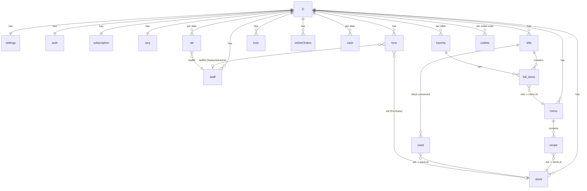

# Setu — Database Structure

**Setu — Restaurant & Hotel POS** · Powered by Aghanya Devanya Enterprises

Setu mein SQL jaisi tables nahi hain. Poora database **ek JSON object `D`** hai. Ye object browser ke localStorage mein ek hi key par save hota hai, aur har save par uski copy IndexedDB mein bhi jaati hai.

---

## 1. Storage Locations

| Store | Key / Naam | Kya hai |
|---|---|---|
| **Server file (Desktop / LAN mode)** | `%LOCALAPPDATA%\AghanyaDevanyaERP\Data\setu-db.json` | **Main database** jab Setu Desktop App (EXE) ya `app_main.py` se chale — `{version, savedAt, data: D}`. Saare devices (PC, phone, tablet) yahi padhte/likhte hain |
| Server file | `Data\Backups\setu-YYYY-MM-DD.json` | Roz ka auto-backup (60 din) |
| Server file | `Data\setu-devices.json` | Jude hue phone/tablet ke login tokens |
| localStorage | `hotelerp_v1` | **Browser mode** ka database (aur Desktop mode mein pehli baar file mein shift hone wala purana data) |
| localStorage | `setu_device_token` | Phone/tablet ka LAN login token |
| localStorage | `hotelerp_auth` | Abhi login hua user (session) — `{name, role, time}` |
| IndexedDB | DB `AghanyaDevanyaERP_DB` (v2) → store `erp_state` → record `id: "primary"` | Mirror copy — `{id, data: D, updated: <timestamp>}`. Abhi sirf likha jata hai, padha nahi jata |
| Backup file | `restaurant-pos-backup-YYYY-MM-DD.json` | Poora `D`, haath se download |
| Outlet file | `outlet-<CODE>-YYYY-MM-DD.json` | Sirf din-wise totals (dekhein §16) |

**Code mein:** `load()` padhta hai, `save()` likhta hai. Purane data mein naye fields `ensureGrowth()` bharta hai, aur naye install ka data `seed()` banata hai.

---

## 2. Overview Diagram



---

## 3. Root Object `D`

```js
D = {
  auth: {...},            // §4  owner login
  settings: {...},        // §5  restaurant + feature settings
  subscription: {...},    // §6  license
  menu: [ ... ],          // §7  dishes
  stock: [ ... ],         // §8  raw material
  bills: [ ... ],         // §9  final (pakka) bills
  kaccha: { "T-4": ... }, // §10 running table orders
  txns: [ ... ],          // §11 purchase / expense / income vouchers
  cash: { "2026-10-08": ... }, // §12 cash counter
  onlineOrders: [ ... ],  // §13 Zomato / Swiggy desk
  kots: [ ... ],          // §14 kitchen display tickets
  reservations: [ ... ],  // §16b table bookings
  staff: [ ... ],         // §15 employees
  att: { "2026-10-08": {...} }, // §15 attendance
  outlets: { "OUT-AB12": ... }, // §16 imported branch summaries
  seq: { bill: 0, kot: 0, token: 0, tokenDate: "" }, // §17 running numbers
  demoCleanupDone: true         // §17 one-time flag
}
```

Saari dates `YYYY-MM-DD` string mein hoti hain aur time `HH:MM` mein. Paisa ₹ mein number (2 decimal tak). `id` = `uid()`, yaani time + random se bani chhoti string (jaise `mg5x1k2abcd`).

---

## 4. `auth` — Owner Login

| Field | Type | Matlab |
|---|---|---|
| `isRegistered` | boolean | Sign Up ho chuka hai ya nahi |
| `userId` | string | Login ID |
| `password` | string | ⚠️ **Plain text** mein save hai (encrypted nahi) |
| `ownerName` | string | Owner ka naam |
| `phone` | string | Owner mobile (isse bhi login hota hai) |
| `registeredAt` | number | Sign Up ka timestamp (ms) |

---

## 5. `settings` — Restaurant & Features

| Field | Type | Default | Matlab |
|---|---|---|---|
| `name` | string | `""` | Restaurant naam (bill par) |
| `address` | string | `""` | Address |
| `phone` | string | `""` | Restaurant phone |
| `gstin` | string | `""` | GSTIN |
| `gst` | number | `5` | GST % (CGST + SGST aadha-aadha) |
| `owner` | string | `""` | Owner WhatsApp (daily report) |
| `footer` | string | "Thank you…" | Bill ke neeche message |
| `adminPin` | string | `"1234"` | Manager PIN (Sign Up password bhi yahi ban jata hai) |
| `cashierPin` | string | `"1111"` | Cashier PIN |
| `width` | number | `80` | Thermal roll: `80` ya `58` mm |
| `billPaper` / `kotPaper` | string | `"A6"` | `"A6"` ya `"thermal"` |
| `tables` | string[] | `T-1…T-8, Parcel` | Table list |
| `zomatoEnabled` / `swiggyEnabled` | boolean | `false` | Aggregator ON/OFF |
| `zomatoId` / `swiggyId` | string | — | Restaurant / Store ID |
| `zomatoComm` / `swiggyComm` | number | `18` / `20` | Commission % (report mein net) |
| `orderWa` | string | `""` | QR menu orders ka WhatsApp number |
| `menuUrl` | string | `""` | Online menu page link |
| `review` | string | `""` | Google review link |
| `upi` | string | `""` | UPI ID (Scan & Pay QR) |
| `loyalty` | boolean | `true` | Loyalty ON/OFF |
| `ptsPer100` | number | `5` | Har ₹100 par points |
| `ptValue` | number | `1` | 1 point = ₹ |
| `minRedeem` | number | `50` | Kam se kam points redeem ke liye |
| `kotLate` | number | `20` | Kitchen alert (minutes) |
| `tokenOn` | boolean | `false` | Takeaway bills par token number |
| `outletCode` | string | `OUT-XXXX` (random) | Is outlet ki pehchaan (multi-outlet) |
| `installId` | string | `SETU-XXXX-XXXX` (random) | License key isi se bandhi hoti hai |
| `gstScheme` | string | `regular` | `regular` / `composition` (Bill of Supply, GST 0) / `none` |
| `fssai` | string | `""` | FSSAI number (bill par) |
| `gstInclusive` | boolean | `false` | `true` = menu rate mein GST shamil; bill par Taxable + GST ulta nikal kar dikhta hai |
| `maxDiscPct` | number | `10` | Cashier ki discount limit %; zyada par Manager PIN |
| `caName`, `caWa` | string | `""` | CA / Lawyer ka naam aur WhatsApp (Monthly Report) |
| `printMode` | string | `dialog` | `dialog` (print box) / `direct` (thermal, bina popup) |
| `billPrinter`, `kotPrinter` | string | `""` | Windows printer ke naam |
| `catPrinters` | object | `{}` | `{ "Chinese": "Printer naam" }` — section-wise KOT |
| `autoKot`, `drawerKick` | boolean | `false` | KOT apne aap print · Cash bill par galla khole |

---

## 6. `subscription` — License

| Field | Type | Matlab |
|---|---|---|
| `status` | string | `inactive` / `active` / `lifetime` |
| `planName` | string | Jaise "1 Month (30 Days)" |
| `validUntil` | string | `YYYY-MM-DD`, ya demo keys ke liye full ISO time. Lifetime = `2099-12-31` |
| `isLifetime` | boolean | Lifetime license |
| `monthlyPrice` | number | `999` (sirf history mein dikhane ke liye) |
| `registeredEntity` | string | Hamesha "Aghanya Devanya Enterprises" |
| `usedKeys` | string[] | Use ho chuki keys (dobara use rokne ke liye) |
| `lastSeen` | number | Setu ne aakhri baar kab chala (ms). Date peeche karne par lock |
| `history` | object[] | `{date, time, amount, method, status, txnId: "KEY-<key>"}` |

`daysLeft`, `isExpired` aur `isExpiring` save nahi hote. Ye `getSubscriptionInfo()` har baar hisaab lagata hai.

---

## 7. `menu[]` — Dishes

| Field | Type | Matlab |
|---|---|---|
| `id` | string | Unique ID |
| `name` | string | Dish naam |
| `cat` | string | Category (default `"General"`) |
| `price` | number | Selling price (GST se pehle) |
| `recipe` | `{sid, qty}[]` | Ek plate mein kaunsa stock kitna. `sid` → `stock.id` |

## 8. `stock[]` — Raw Material

| Field | Type | Matlab |
|---|---|---|
| `id` | string | Unique ID |
| `name` | string | Jaise "Paneer" |
| `unit` | string | `kg` / `gm` / `ltr` / `pcs` / `pkt` / `dozen` |
| `qty` | number | Abhi ka stock (3 decimal) |
| `min` | number | Low stock alert level |
| `rate` | number | ₹ per unit (valuation) |

Stock badalta hai: bill save par minus, bill cancel par plus, purchase par plus, aur Physical Count par seedha set.

---

## 9. `bills[]` — Pakka (Final) Bills

| Field | Type | Matlab |
|---|---|---|
| `id` | string | Unique ID |
| `no` | number | Bill number (`seq.bill`) |
| `kot` | number | KOT number (`seq.kot`) |
| `date`, `time` | string | Bill kab bana |
| `channel` | string | `Dine-In` / `Takeaway` / `Zomato` / `Swiggy` |
| `orderId` | string | Zomato/Swiggy order ID |
| `table` | string | Table ya reference |
| `cust`, `phone` | string | Customer naam, mobile. **Customer database isi se banta hai** |
| `note` | string | Kitchen note |
| `mode` | string | `Cash` / `UPI` / `Card` / `Credit` / `Wallet` / `Zomato Pay` / `Swiggy Pay` |
| `token` | number | Takeaway token number (0 = nahi) |
| `gstRate` | number | Bill ke waqt ka GST % |
| `items` | `{mid, name, price, qty}[]` | Dishes. `mid` → `menu.id`, aur naam/price bill ke waqt ke copy hote hain |
| `sub` | number | Items ka total |
| `disc` | number | **Kul discount** (manual + loyalty) |
| `taxable` | number | `sub − disc` |
| `tax` | number | GST amount |
| `round` | number | Round off |
| `total` | number | Final amount (poore rupaye) |
| `ptsEarned` | number | Is bill se mile points |
| `ptsUsed` | number | Is bill mein use hue points |
| `loyaltyDisc` | number | `disc` mein se kitna loyalty ka tha |
| `used` | `{sid, qty}[]` | Kitna stock ghata (cancel par wapas judta hai) |
| `cancelled` | boolean | Cancel hua to `true` (bill delete nahi hota) |
| `cancelledBy` | string | Kis Manager ne cancel approve kiya |
| `by` | string | Kis staff ne bill banaya |
| `scheme` | string | Bill ke waqt ka GST type (`regular` / `composition` / `none`) |
| `incl` | boolean | `true` = rate mein GST shamil tha (taxable = total ÷ 1.05) |
| `prints` | number | Customer copy kitni baar print hui (2+ = DUPLICATE COPY) |

**Hisaab:** `calc(items, disc, gst)` se: `taxable = sub − disc`, `tax = taxable × gst%`, `total = round(taxable + tax)`.

**Loyalty balance** kahin alag save nahi hota. Wo `Σ(ptsEarned − ptsUsed)` hai, un bills par jo cancel nahi hue aur us phone number ke hain.

---

## 10. `kaccha{}` — Running Table Orders

Key = table naam (jaise `"T-4"`). Pakka bill bante hi entry delete ho jaati hai.

| Field | Type | Matlab |
|---|---|---|
| `table` | string | Table naam |
| `cust`, `phone`, `note` | string | Customer details |
| `disc` | number | Manual discount |
| `mode` | string | Payment mode (chuna hua) |
| `cart` | `{mid, name, price, qty}[]` | Ab tak ka order |
| `redeem` | number | Redeem kiye jaane wale points |
| `sent` | `{ [menuId]: qty }` | **Kitchen ko kitna ja chuka.** Naya KOT sirf isse zyada ka banta hai |
| `createdAt`, `updatedAt` | string | Time |
| `total`, `sub`, `tax` | number | Aakhri save ke waqt ka hisaab (sirf dikhane ke liye) |

---

## 11. `txns[]` — Vouchers

| Field | Type | Matlab |
|---|---|---|
| `id` | string | Unique ID |
| `type` | string | `Purchase` / `Expense` / `Receipt` |
| `date`, `time` | string | Kab |
| `head` | string | Category (jaise "Gas Cylinder", "Staff Salary / Wages", "Staff Advance"). Khaas heads neeche dekhein |
| `desc` | string | Details |
| `party` | string | Kisko diya / kisse aaya |
| `amount` | number | ₹ |
| `mode` | string | `Cash` / `UPI` / `Card` / `Credit` |
| `sid`, `qty` | string, number | *(Purchase)* kaunsa stock, kitna aaya |
| `staffId` | string | *(Salary/Advance)* → `staff.id` |
| `phone` | string | *(Customer Wallet Topup)* customer mobile |
| `salMonth` | string | *(Salary)* `YYYY-MM` |

**Khaas heads** (cash hilta hai, lekin margin mein kamai/kharcha nahi gine jaate, taaki do baar na gine):

| Head | Type | Kyun |
|---|---|---|
| `Customer Wallet Topup` | Receipt | Customer ne advance diya. Kamai tab ginee jaati hai jab bill Wallet se pay ho |
| `Zomato Settlement` / `Swiggy Settlement` | Receipt | Bank mein payout aaya. Sale pehle hi bill mein ginee ja chuki hai |
| `Supplier Payment` | Expense | Udhaar chukaya. Kharid pehle hi Purchase mein ginee ja chuki hai |

Supplier ka baaki = `Credit` mode Purchases − `Supplier Payment` (party naam se). Wallet balance = Topups − `Wallet` mode bills (phone se).

## 12. `cash{}` — Cash Counter

Key = date. `{ opening: number, den: { "500": 3, "100": 12, ... }, time: "HH:MM" }`. Notes `[500, 200, 100, 50, 20, 10, 5, 2, 1]`. Agle din ka opening = pichhle din ka counted cash.

## 13. `onlineOrders[]` — Zomato / Swiggy Desk

| Field | Type | Matlab |
|---|---|---|
| `id` | string | Unique ID |
| `channel` | string | `Zomato` / `Swiggy` |
| `orderId` | string | `ZOM-1234` / `SWIG-1234` |
| `custName`, `custPhone`, `address` | string | Customer |
| `riderName`, `otp` | string | Delivery |
| `items` | `{mid, name, price, qty}[]` | Order |
| `sub`, `disc`, `taxable`, `tax`, `round`, `total` | number | Hisaab |
| `status` | string | `new` → `accepted` → `ready` → `completed` |
| `createdAt`, `date`, `note` | string | — |

Reject karne par order delete ho jata hai. Handover par ek `bills[]` entry banti hai. ⚠️ Completed orders kabhi delete nahi hote.

## 14. `kots[]` — Kitchen Display Tickets

| Field | Type | Matlab |
|---|---|---|
| `id` | string | Unique ID |
| `no` | number | KOT number |
| `date`, `time` | string | Kab bana |
| `at` | number | Timestamp (ms), "kitne minute se" ke liye |
| `table` | string | Table / `Zomato #ID` / `Parcel · naam` |
| `channel` | string | `Dine-In` / `Takeaway` / `Zomato` / `Swiggy` |
| `items` | `{name, qty}[]` | Sirf naye items (delta) |
| `note` | string | Kitchen note |
| `token` | number | Takeaway token (Token Display ke liye) |
| `by` | string | Kis staff/captain ne order bheja |
| `status` | string | `new` → `ready` → `served` |
| `readyAt`, `servedAt` | number | Timestamps |

Sirf **pichhle 7 din** ke KOT rakhe jaate hain.

## 15. `staff[]` aur `att{}` — Staff & Attendance

`staff[]`:

| Field | Type | Matlab |
|---|---|---|
| `id` | string | Unique ID |
| `name`, `role`, `phone` | string | Details |
| `salary` | number | Monthly salary |
| `access` | string | `""` / `captain` / `cashier` / `manager` — software login |
| `pin` | string | Staff ka login PIN (4-6 digit). ⚠️ plain text |
| `left` | boolean | Kaam chhod diya (record rehta hai) |

`att{}`: key = date → `{ [staffId]: "P" | "H" | "A" | "W" }` — roz ki haaziri (W = weekly off, paid)

`salaryDays{}`: key = month `YYYY-MM` → `{ [staffId]: din }` — salary sheet mein bhare gaye "Din Aaye" (0.5 step). Sirf manual override rakha jata hai (haaziri se alag number). Na ho to din = `att` se P + W + H/2.

**Salary formula:** `earned = salary ÷ mahine ke din × din aaye` (din aaye = manual `salaryDays` ya `P + W + H/2`), aur `payable = earned − advance − paid`. Advance aur paid dono `txns` se aate hain.

## 16. `outlets{}` — Multi-Outlet

Key = doosre outlet ka `outletCode`. Value = us outlet ki summary file:

```js
{
  type: "aghanya-outlet-summary",
  code: "OUT-AB12", name: "Branch 2",
  exportedAt: "2026-10-08T10:30:00.000Z",
  lowStock: 2,
  days: {
    "2026-10-08": { bills, sales, dine, take, zom, swg, exp, pur, rec,
                    top: [["Dal Tadka", 14], ...] }   // top 5 dishes
  }
}
```

Isme pichhle 90 din ke totals hote hain. **Customer ka naam ya number nahi jaata.** Is outlet ki apni summary live banti hai, save nahi hoti.

## 16-CA. `monthlySent{}` — CA ko Monthly Report kab bheji

Key = month `YYYY-MM` → `{date, time, to}`. Na ho to dashboard 1–10 tarikh ko yaad dilata hai.

## 16a. `audit[]` — Kisne Kya Kiya (Chori Check)

| Field | Type | Matlab |
|---|---|---|
| `id`, `at` | string, number | ID, timestamp |
| `date`, `time` | string | Kab |
| `user`, `role` | string | Kisne kiya (staff naam, access) |
| `action` | string | `Login`, `Bill Cancel`, `KOT ke baad item hataya`, `Discount`, `Duplicate Bill Print`, `Voucher Delete`, `Cash Short`, `Stock Adjust`, `Menu Rate Change`, `Galat Manager PIN`, `Settings Change`, `Backup Restore`… |
| `detail` | string | Bill no., table, items |
| `amount` | number | ₹ asar |
| `ref` | string | Bill / table / entry ki ID |
| `approvedBy` | string | Kis Manager ne PIN se approve kiya |

Lagbhag 20,000 entries tak rakhi jaati hain.

## 16b. `reservations[]` — Table Booking

| Field | Type | Matlab |
|---|---|---|
| `id` | string | Unique ID |
| `name`, `phone` | string | Customer |
| `date`, `time` | string | Booking kab ki hai |
| `people` | number | Kitne log |
| `table` | string | Table (khaali = baad mein) |
| `note` | string | Birthday, window seat… |
| `status` | string | `booked` / `arrived` / `cancelled` / `noshow` |
| `createdAt` | number | Timestamp |

Aaj ki `booked` reservation wali table Billing aur Captain App mein "Reserved HH:MM" dikhti hai.

## 17. Baaki

| Field | Matlab |
|---|---|
| `seq.bill` | Aakhri bill number. Naya bill = `++seq.bill` |
| `seq.kot` | Aakhri KOT number. Running table ke har naye KOT par bhi badhta hai |
| `seq.token`, `seq.tokenDate` | Takeaway token number. Har din 1 se shuru (`nextToken()`) |
| `demoCleanupDone` | `true` = purana demo-data cleanup dobara kabhi nahi chalega |

---

## 18. Jo Save Nahi Hota (Har Baar Hisaab)

| Cheez | Function | Kahan se |
|---|---|---|
| Customer list (visits, spend, favourite) | `customers()` | `bills` (phone wale, Zomato/Swiggy chhod kar) |
| Loyalty points balance | `ptsBal()`, `ptsBalAt()` | `bills.ptsEarned − ptsUsed` |
| Din ka hisaab (sales, channel, cash) | `summary(date)` | `bills` + `txns` + `cash` |
| Low stock | `lowStock()` | `stock.qty ≤ min` |
| License din bache | `getSubscriptionInfo()` | `subscription.validUntil` |
| Pending KOT | `pendingKots()` | `kots.status ≠ served` |

---

## 19. Size Andaza

| Record | Approx characters |
|---|---|
| Ek bill (4 items) | ~660 |
| Ek KOT | ~320 |
| localStorage limit | ~50 lakh (~5 MB) |

150 bills/din wale restaurant mein localStorage lagbhag 40–50 din mein bhar jayega (detail ke liye `DB-CRASH-RISKS.md` dekhein).

---

## 20. Dhyan Dene Wali Baatein

- **Password plain text mein** hai (`auth.password`, `settings.adminPin`, `cashierPin`). Backup file khol kar koi bhi padh sakta hai. Backup file share na karein.
- **Restore poora `D` replace karta hai**, license aur login samet.
- **Bills, txns aur onlineOrders kabhi delete nahi hote.** Cancel sirf `cancelled: true` lagata hai. Isliye data hamesha badhta rehta hai.
- **Naya field jodna ho** to `seed()` aur `ensureGrowth()` dono mein default dein, warna purane clients ka data crash karega.
