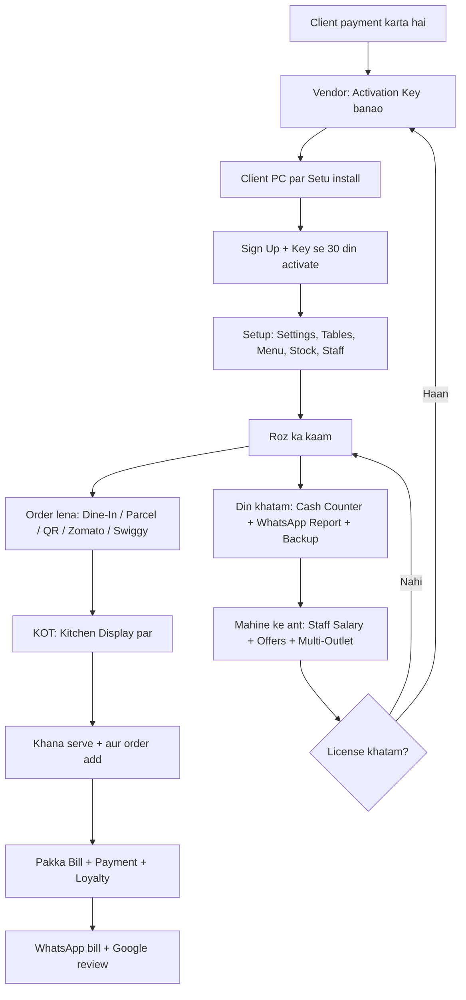
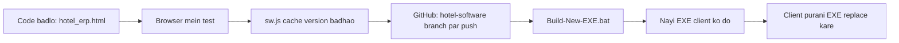

# Setu — End-to-End Workflow

**Setu — Restaurant & Hotel POS** · Powered by Aghanya Devanya Enterprises

Ye document Setu ka poora safar step-by-step batata hai: naye client ko software dene se lekar restaurant ke roz ke kaam, din ka hisaab, license renewal aur software update tak.

---

## Poora Flow Ek Nazar Mein

---

## Bhaag 1 — Vendor (Aghanya Devanya Enterprises) ka Kaam

### 1.1 Naye client ko key dena
1. Client se payment lein (1 mahina / 2 / 3 / 6 mahine / 1 saal / Lifetime).
2. Client se uska **Install ID** lein (jaise `SETU-7F3K-92QD`). Ye Setu ki Sign Up / Lock / License screen par "Copy" button ke saath dikhta hai.
3. **`Generate-Activation-Keys.bat`** chalayein → Install ID → plan (`1m 2m 3m 6m 1y life`) → hotel ka naam.
4. Lambi key (`SETU-AEAQ...`) client ko WhatsApp par bhejein. Client use **copy-paste** karega.
5. Har key **sirf usi computer** par aur **sirf ek baar** chalti hai. Record `Activation_Keys/Setu_Issued_Keys.csv` mein apne aap save hota hai.

> **`setu-license-private.pem`** sirf aapke paas rehni chahiye (backup pen-drive/Drive par). Ye kho gayi to nayi keys nahi banengi; kisi ko mili to wo keys bana lega. GitHub par kabhi nahi.
> Demo dikhane ke liye `AD-DEMO-24HR-TEST` (har PC par ek baar).

### 1.2 Client ke PC par install
1. Pen-drive se ye files client ke PC par ek folder mein copy karein: `Aghanya-Devanya-Hotel-ERP.exe` (ya `hotel_erp.html` + icons).
2. **`Install-Aghanya-Devanya-ERP-Setup.bat`** chalayein. Desktop aur Start Menu par Setu ka icon ban jayega.
3. Icon par double-click → Setu khulega.

### 1.3 Purani `AD-01M-...` keys
- Wo ab kaam nahi karti (koi bhi unhe bana sakta tha). Jo clients pehle activate ho chuke hain, unka license expiry tak chalta rahega. Renewal par nayi `SETU-...` key dein.

---

## Bhaag 2 — Pehli Baar Setup (Restaurant Owner)

### 2.1 Sign Up (sirf ek baar)
1. Setu pehli baar khulte hi **"Setu — New Restaurant Sign Up"** screen aayegi.
2. Bharein: Hotel/Restaurant naam, Owner naam, Mobile, User ID, Password, aur vendor se mili **Activation Key**.
3. **Sign Up & Activate** → license chalu → apne User ID + Password se **Sign In** karein.

### 2.2 Settings (G)
| Kya bharein | Kyun |
|---|---|
| Restaurant naam, address, phone, GSTIN, GST % | Bill par chhapta hai |
| Owner WhatsApp number | Roz ki report yahin jaati hai |
| Bill / KOT paper size (A6 ya Thermal 58/80 mm) | Printer ke hisaab se |
| Tables list (T-1, T-2 … Parcel) | Billing aur QR ke liye |
| Order WhatsApp number, Menu link | QR menu orders ke liye |
| Google Review link, UPI ID | Bill par review QR aur Scan & Pay QR |
| Loyalty ON/OFF, points per ₹100, 1 point = ₹, min redeem | Customer points |
| KOT late alert (minutes) | Kitchen screen par laal alert |
| Zomato/Swiggy commission % | Report mein net kamai |
| Admin PIN, Cashier PIN | Owner aur purana common cashier login |
| GST Type (Regular / Composition / Registered nahi), FSSAI No. | Bill ka title (Tax Invoice / Bill of Supply) aur FSSAI number bill par |
| Menu Rate mein GST: Shamil hai | Menu ka ₹80 hi customer dega; bill par dikhega ki usme kitna GST tha (₹76.19 + ₹3.81) |
| Cashier max discount % | Isse zyada discount par Manager PIN lagega |
| Printer Setup | Thermal printer par bina popup print, Tandoor/Chinese/Bar ke alag KOT printer, auto KOT, cash drawer |

### 2.3 Menu (M)
0. Poora menu pehle se Excel (CSV) mein ho ya kaagaz se type kiya ho: **"Menu Import (Excel / Paste)"** → file chunein ya paste karein (har line `Category, Dish, Price`, ya chhapa hua menu jaisa) → **Menu mein Jodein**.
1. **"+ Menu Items Add Karein (Ek Saath)"** dabayein.
2. Naam → Tab → Category → Tab → Price → **Enter** (nayi line aati hai, category wahi rehti hai).
3. Saari dishes likh kar ek baar **Save All**.
4. Stock apne aap ghatana ho to dish par **Edit** → Recipe mein raw material jodein.

### 2.4 Stock (S)
- **New Stock Item** → naam, unit, opening qty, min alert level, rate.
- Bill banne par recipe ke hisaab se stock apne aap kam hota hai. Min se neeche jaane par "Low Stock" alert aata hai.

### 2.5 Staff (A) + Login PIN
- Har staff ko **Software Access** dein: Captain (sirf order), Cashier (billing), Manager (sab + approval), aur apna **4-6 digit PIN**.
- Cashier/Captain login: Sign In → "Billing Staff / Cashier" → apna PIN. Phone par bhi wahi PIN.
- Bill cancel, KOT ke baad item hatana, entry delete, limit se zyada discount aur Settings/Reports par **Manager PIN** maanga jata hai.
- **+ Add Staff** → naam, kaam (Chef/Waiter…), mobile, monthly salary.

### 2.6 QR Menu (Q) — optional
1. **Menu Page Download** → `menu.html` ko netlify.com/drop par daal kar link lein → link Save karein.
2. **Sab Tables ke QR Print** karein → har table par chipkayein.
3. UPI ID ho to **Counter ke liye UPI standee** print karein.

### 2.7 Phone / Tablet Jodna (Captain App, Kitchen Tablet, Owner Phone)
1. Main Counter PC par **Setu Desktop App (EXE)** chalayein. (Bina window ke sirf server: `Start-ERP-Server.bat`)
2. Windows Firewall poochhe to **Private network → Allow** karein.
3. **Settings (G) → "Phone / Tablet Connect"** mein QR aur link dikhega (jaise `http://192.168.1.6:8000/hotel_erp.html`).
4. Phone/tablet ko **usi WiFi** se jodein → QR scan karein → **Manager ya Cashier PIN** daalein. Ek baar jud gaya to dobara PIN nahi maangta.
5. Waiter ke phone par **Captain App (N)**, kitchen tablet par **Kitchen Display (T) → Full Screen**, counter ke TV par **Token Display (X) → Full Screen**.

> Saara data Main Counter PC par rehta hai. Wo PC band ho to phone/tablet kaam nahi karenge.

### 2.8 Token System (Takeaway / QSR) — optional
- **Settings (G) → Takeaway Token System: ON.** Har parcel bill par token number (roz 1 se) chhapta hai.

---

## Bhaag 3 — Roz ka Kaam (Order se Payment tak)

### 3.1 Din shuru
1. Setu kholein → **Sign In** (Owner ya Cashier PIN).
2. Kitchen ke tablet/second monitor par **Kitchen Display (T)** → **Full Screen Kitchen Mode**.
3. **Cash Counter (C)** mein opening cash (galla) check karein.

### 3.2 Order aane ke 6 raaste

| Order kahan se | Kya karein | KOT |
|---|---|---|
| **Dine-In table** | Billing (B) → Dine-In → table chunein → items → **Save Kaccha Bill (KOT)** | Kitchen screen par turant |
| **Waiter ka phone (Captain App)** | Captain App (N) → table → items (+/−) → **KOT Bhejein** | Turant, counter par table ka Kaccha Bill bhi update |
| **Parcel / Takeaway** | Billing → Takeaway → items → **Finalize & Pakka Bill** (Token ON ho to token no. milta hai) | Pakka bill par |
| **QR menu (WhatsApp)** | QR Menu (Q) → message paste → **Order Lein + KOT Bhejein** | Turant, us table ke Kaccha Bill mein |
| **Zomato / Swiggy (tablet se)** | Zomato & Swiggy Live (Z) → **+ Zomato/Swiggy Order Entry** → items + Order ID → Pakka Bill | Pakka bill par |
| **Zomato / Swiggy (live desk)** | Order card par **Accept & Print KOT** → Ready → **Handover & Settle** | Accept karte hi |

### 3.3 Running table — order badhna (jaise 3 roti, phir 5 roti)
1. Pehla order: 3 Roti → **Save Kaccha Bill** → KOT: **3 × Roti**.
2. Customer ne aur maanga: neeche **Active Tables** mein table par click → 5 Roti aur → **Save Kaccha Bill** → KOT sirf **5 × Roti**.
3. Bill par ek hi line: **Roti × 8**.
4. Kuch wapas/nahi khaya to Pakka Bill se pehle Qty **−** kar dein.

### 3.4 Kitchen
1. KOT card aata hai: Orange = naya, Red = der ho rahi hai, Green = ready.
2. Khana tayyar → **Food Ready** → serve hone par **Served**.
3. Token wala parcel "Food Ready" hote hi **Token Display (X)** par "Collect Karein" mein aa jata hai.

### 3.4b Table Booking (H)
- Phone par booking aaye → **Table Reservations (H)** → naam, time, log, table → Save → WhatsApp confirmation.
- Aaj ki booked table Billing aur Captain App mein **"Reserved 20:00"** dikhti hai. Customer aaye to status **Aa Gaye**.

### 3.5 Bill aur Payment
1. Table kholein → discount (agar ho) → customer ka **mobile number** daalein.
2. Purana customer ho to naam apne aap aa jata hai aur **loyalty points** dikhte hain → **Redeem Points** (optional).
3. Payment mode chunein: Cash / UPI / Card / Credit (Udhaar) / **Wallet** (customer ka advance balance — mobile number daalte hi dikhta hai).
4. **Finalize & Pakka Bill** (Ctrl+Enter) → table free.
5. Print: Customer Bill + KOT, ya sirf Bill.
6. **Customer WhatsApp Bill** → bill + points + Google review link customer ko chala jata hai.

### 3.6 Din ke beech ke kharche
- **Purchase (P):** saamaan aaya → stock badhta hai. Supplier ka naam zaroor likhein. Paisa baad mein dena ho to mode **Credit**.
- **Expense (E):** gas, sabzi, bijli, staff advance…
- **Other Income (I):** purana udhaar aaya, advance booking…

---

## Bhaag 4 — Din Khatam (Closing)

0. **Audit Log (V)** dekhein: kisne bill cancel kiya, KOT ke baad item hataya, discount diya, duplicate bill print kiya, galla short. Ye sab daily WhatsApp report mein bhi aata hai.

1. **Bill List (L):** aaj ke bills check karein. Galat bill ho to **Cancel** (stock wapas judta hai).
2. **Day Book (D):** saari entries aur mode-wise sale.
3. **Cash Counter (C):** galle ke note ginkar daalein → Expected vs Counted → **Save & WhatsApp Owner**.
4. **Day Report (W):** **Owner ko WhatsApp Bhejein**. Isme sales, Dine-In/Parcel/Zomato/Swiggy, commission ke baad net, kharche, top dishes aur low stock hota hai.
5. **Staff (A):** aaj ki haaziri: P / H / A, ya **Baaki Sab Present**.
6. **Settings (G) → Download JSON Backup** → pen-drive/Google Drive mein rakhein. **Roz zaroor.**

---

## Bhaag 5 — Hafte / Mahine ka Kaam

### 5.1 Customers & Offers (R)
1. Group chunein: Sab / Repeat / 30+ din se nahi aaye / Top 20 / Points wale.
2. Message likhein (`{name}`, `{points}` apne aap bharte hain) → **Ek-ek karke WhatsApp** → har customer par Send.
3. **Excel (CSV)** se customer list nikalein.
4. **Wallet Top-up:** customer advance de → **+ Wallet Top-up** → mobile, naam, amount → WhatsApp par balance. Agle bill mein mode **Wallet**.

### 5.1b Suppliers & Udhaar (U)
- Har supplier ka kul kharid, udhaar, diya aur **baaki** dikhta hai. **Pay** → Cash/UPI → baaki ghat jata hai. **Ledger** se poori history.

### 5.1c Zomato / Swiggy Settlement (Y)
1. Date range chunein → Gross sale, commission, **aana chahiye**.
2. Bank mein payout aaye → **+ Payment Aaya** → amount + UTR.
3. **Farak** dikhe to Zomato/Swiggy partner app ki payout statement se milaayein.

### 5.1c-2 Monthly Report → CA / Lawyer (J)
1. Ek baar Settings (G) mein **CA / Lawyer ka naam aur WhatsApp number** daalein.
2. Mahine ki 1–10 tarikh ko dashboard par yaad dilaya jata hai. **Monthly Report (J)** → mahina chunein.
3. **"CA / Lawyer ko WhatsApp"** → poora hisaab (sale, GST rate-wise, payment mode, channel, kharcha) CA ke WhatsApp par khulta hai — Send dabayein.
4. **GST Bill Register (Excel)** aur **Print / PDF** CA ko file ke roop mein bhejein (WhatsApp mein file khud attach karni hoti hai).
5. Bhejne ki date screen par dikhti hai aur Audit Log mein bhi jaati hai.

### 5.1d Reports & Tally (F)
- Aaj / Kal / 7 Din / Is Mahine → Summary, Item-wise, Category, Hourly, Payment Mode, Channel, **GST Summary**, Discounts, Cancelled, Kharcha, Top Customers.
- Har report **Excel (CSV)** mein. CA ke liye **Tally XML Export** (Tally mein pehle ledgers banayein: Sales, CGST, SGST, Round Off, Cash, UPI, Card, Credit Sales, Customer Wallet, Zomato, Swiggy).

### 5.2 Staff Salary (A) — mahine mein ek baar
1. Staff add karte waqt hi **Monthly Salary** daalein (ek baar). Har mahine wahi chalti hai.
2. **Roz haaziri:** Staff (A) → "Aaj ki Haaziri" → P / H / A / W (W = Weekly Off, paid) ya **"Baaki Sab Present"**.
3. **"Din Aaye" apne aap banta hai:** P + W + H/2. Purane din ki galti **"Poore Mahine ki Haaziri"** chart mein khane par click karke theek karein.
4. Mahine ke end mein Salary Sheet dekhein → **"Sabko Salary Pay"** (ek click, Cash/UPI) ya har line par **Pay**.
5. Kisi ke din haath se badalne hon to number badal kar Save — wo "Manual" dikhega (Audit Log mein bhi). "Auto karein" se wapas haaziri wala.
6. Banti Salary = Monthly Salary ÷ mahine ke din × Din Aaye − Advance. Payment Expense mein apne aap judta hai.
5. **Slip** → staff ko WhatsApp par salary slip.

### 5.3 Multi-Outlet (O) — ek se zyada branch
1. Har branch: **"Is Outlet ki Summary File Download"** → owner ko bhejein.
2. Owner apne Setu mein: **Outlet Files Import** → saari files ek saath chunein.
3. Date range chunein → har branch ki sales, online, kharcha, net + **Owner ko WhatsApp Summary**.

---

## Bhaag 6 — License Renewal

1. Expiry paas aane par upar **"Expiring: X days left"** dikhta hai.
2. Client vendor ko payment karta hai → vendor nayi key deta hai (Bhaag 1.1).
3. Client: **Aghanya Devanya License (K)** ya Settings → key daalein → **Activate**. Bache hue din + naye din jud jaate hain.
4. Expire ho gaya to poori screen lock ho jaati hai → lock screen par nayi key daalte hi software khul jaata hai. **Data safe rehta hai.**
5. Computer ki date peeche ki gayi ho to bhi lock ho jata hai. Sahi date lagayein ya nayi key dein.

---

## Bhaag 7 — Software Update (Developer / Vendor)

1. Code `hotel_erp.html` mein badlein (niyam `AGENTS.md` mein hain).
2. `python -m http.server 8000` → `http://localhost:8000/hotel_erp.html` → Demo login (demo/demo) + key `AD-DEMO-24HR-TEST` → test.
3. `sw.js` mein `CACHE_NAME` ka version badhayein.
4. GitHub `hotel-software` branch par push.
5. **`Build-New-EXE.bat`** → nayi `Aghanya-Devanya-Hotel-ERP.exe`.
6. Client ke PC par sirf EXE badlein. **Client ka data `%LOCALAPPDATA%\AghanyaDevanyaERP\Data` mein rehta hai, wo nahi mitta.** Update se pehle phir bhi ek Backup le lein.

---

## Shortcut Keys (Gateway screen par)

| Key | Screen | Key | Screen |
|---|---|---|---|
| B | Billing | S | Stock |
| Z | Zomato & Swiggy | M | Menu Items |
| L | Bill List | T | Kitchen Display |
| P | Purchase | Q | QR Menu & Orders |
| E | Expense | R | Customers & Loyalty |
| I | Other Income | A | Staff & Salary |
| D | Day Book | O | Multi-Outlet |
| C | Cash Counter | N | Captain App |
| W | WhatsApp Report | H | Table Reservations |
| F | Reports & Tally | X | Token Display |
| U | Suppliers & Udhaar | Y | Zomato/Swiggy Settlement |
| J | Monthly Report → CA | | |
| V | Audit Log (Chori Check) | K | License |
| G | Settings & Backup | | |

**Esc** = wapas · **Ctrl+Enter** = Pakka Bill · **Alt + letter** = kisi bhi screen se seedha jump

---

## Dhyan Rakhein

- **Desktop App** roz apne aap backup banata hai (`Data\Backups`, 60 din). Phir bhi hafte mein ek baar backup **PC ke bahar** rakhein.
- **Phone/tablet** sirf restaurant ke WiFi par chalte hain. Ghar se dekhne ke liye cloud chahiye, jo abhi nahi hai.
- **Zomato/Swiggy** orders haath se entry hote hain. Seedha API connection ke liye unki partner approval chahiye.
- **WhatsApp offers** ek-ek karke jaate hain. Bulk auto-send ke liye WhatsApp Business API chahiye.
- **Multi-Outlet** file se judta hai, live nahi.
